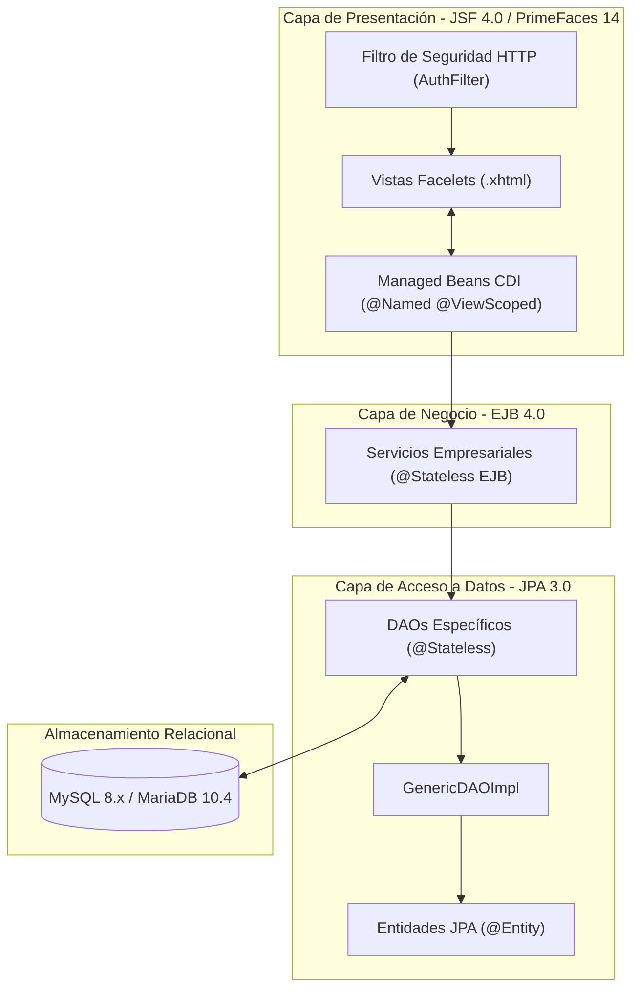
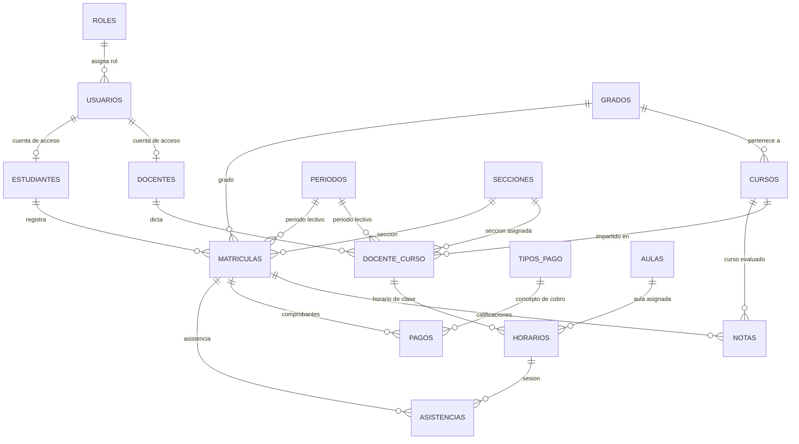
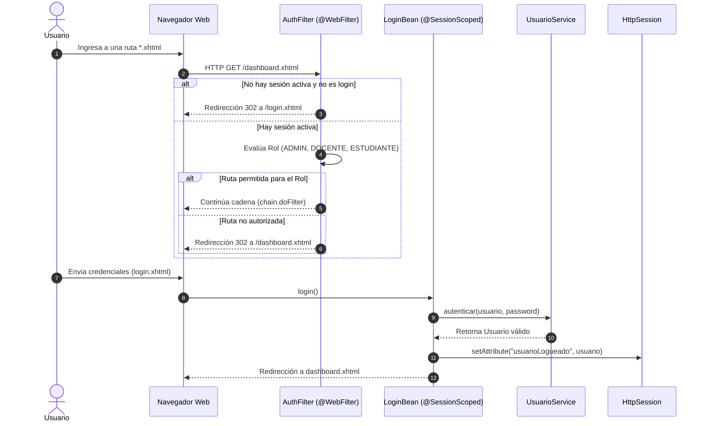

# Documentación Técnica de Arquitectura — EduManager Pro

## 1. Visión General de la Arquitectura

**EduManager Pro** implementa una arquitectura multicapa desacoplada y orientada al estándar empresarial **Jakarta EE 10**, siguiendo los principios de la arquitectura en capas (*Layered Architecture*) y el patrón **MVC (Modelo - Vista - Controlador)**.



---

## 2. Descripción de Capas

### 2.1. Capa de Presentación (Frontend & Controladores)
* **Facelets (XHTML):** Motor de plantillas declarativo que compone la interfaz mediante composición (`<ui:composition>`, `<ui:define>`, `<ui:insert>`). Todas las páginas administrativas heredan de `templates/template.xhtml`.
* **PrimeFaces 14 (Jakarta Classifier):** Conjunto de componentes interactivos con soporte AJAX integrado (`p:dataTable`, `p:dialog`, `p:toolbar`, `p:selectOneMenu`, `p:barChart`, `p:pieChart`).
* **CDI Managed Beans:** Controladores anotados con `@Named` y `@ViewScoped` (o `@SessionScoped` para el contexto de login). Gestionan el estado de la vista, la navegación y orquestan la invocación hacia la capa de servicios.

### 2.2. Capa de Negocio (Servicios EJB)
* **Enterprise Java Beans Stateless (`@Stateless`):** Implementan las reglas de negocio y transaccionalidad JTA.
* **Inyección de Dependencias (`@Inject`):** Comunicación desacoplada entre controladores y servicios, facilitando pruebas y mantenimiento.
* **Lógica de Generación de Identidad:** En `EstudianteServiceImpl` y `DocenteServiceImpl` se generan automáticamente los identificadores de usuario (`nombre.apellido` o `d.nombre.apellido`) vinculados a sus respectivos registros.

### 2.3. Capa de Persistencia (DAOs & JPA)
* **GenericDAO Pattern:** `GenericDAO<T, ID>` define las operaciones CRUD fundamentales (`create`, `update`, `delete`, `findById`, `findAll`).
* **EntityManager:** Inyectado mediante `@PersistenceContext(unitName = "SistemaEscolarPU")`.
* **Consultas Parametrizadas:** Búsquedas especializadas resueltas con `TypedQuery<T>` y parámetros nombrados para evitar vulnerabilidades de inyección SQL.

---

## 3. Modelo Relacional y Entidades

El sistema gestiona 16 entidades relacionales agrupadas por dominios:



---

## 4. Flujo de Autenticación y Autorización (RBAC)



---

## 5. Matriz de Permisos por Rol

| Módulo / Vista | Administrador (`ADMIN`) | Docente (`DOCENTE`) | Estudiante (`ESTUDIANTE`) |
| :--- | :---: | :---: | :---: |
| `/login.xhtml` | Público | Público | Público |
| `/dashboard.xhtml` | Acceso Total (Gráficos y Métricas) | Banner de bienvenida | Banner de bienvenida |
| `/usuarios.xhtml` | CRUD Completo | Denegado | Denegado |
| `/roles.xhtml` | CRUD Completo | Denegado | Denegado |
| `/estudiantes.xhtml` | CRUD Completo | Denegado | Denegado |
| `/docentes.xhtml` | CRUD Completo | Denegado | Denegado |
| `/cursos.xhtml` | CRUD Completo | Denegado | Denegado |
| `/matriculas.xhtml` | CRUD Completo | Denegado | Denegado |
| `/notas.xhtml` | CRUD Completo / Exportación | CRUD Completo / Exportación | Denegado |
| `/pagos.xhtml` | CRUD Completo / Exportación | CRUD Completo / Exportación | Denegado |
| `/perfil-docente.xhtml` | Denegado | Consulta y Edición Propia | Denegado |
| `/mis-cursos.xhtml` | Denegado | Visualización y Lista de Alumnos | Denegado |
| `/mi-perfil.xhtml` | Denegado | Denegado | Consulta y Edición Propia |
| `/mis-notas.xhtml` | Denegado | Denegado | Consulta y Descarga PDF |
| `/mis-pagos.xhtml` | Denegado | Denegado | Consulta de Estado de Cuenta |

---

## 6. Configuración de Base de Datos y Persistencia

### Unidad de Persistencia (`persistence.xml`)
* **Nombre de Unidad:** `SistemaEscolarPU`
* **Tipo de Transacción:** `JTA` (manejada por GlassFish)
* **JNDI DataSource:** `java:app/jdbc/ColegioDS`
* **Estrategia DDL:** `none` (el esquema es administrado mediante el script reproducible SQL `database/db_colegio.sql`).

---

## 7. Pruebas de Compilación y Verificación

La compilación se verifica mediante Maven contra el JDK 17:
```bash
mvn clean test-compile
```
* **Módulos compilados:** 91 clases Java.
* **Resultado:** `BUILD SUCCESS`.
